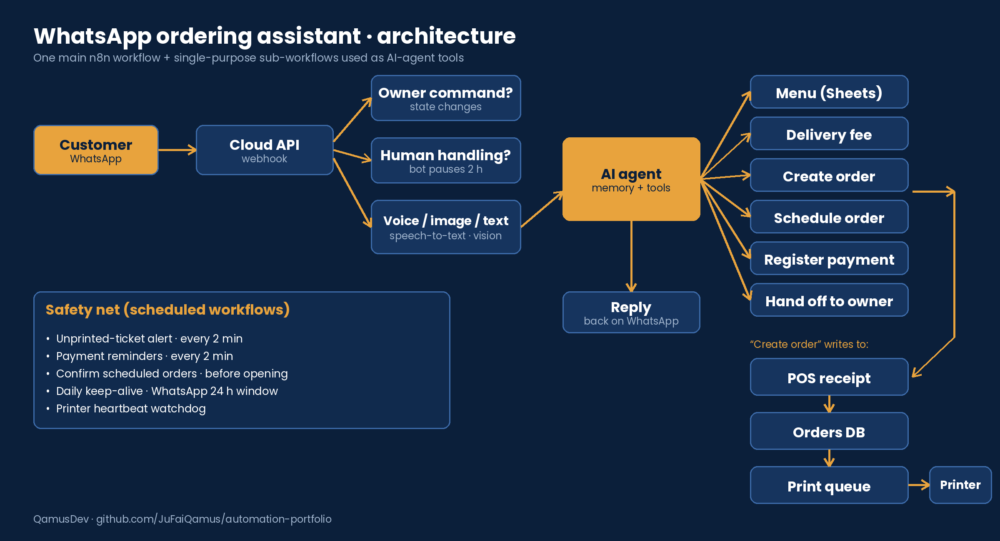
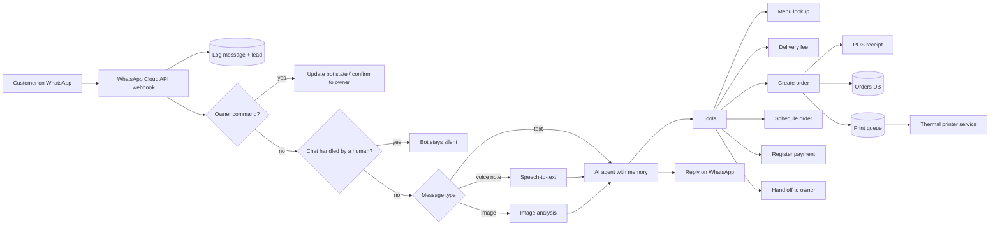

# Case study: WhatsApp ordering assistant for a restaurant

> Client details are anonymized. No names, phone numbers, IDs or credentials appear in this repository.

**Client profile:** Independent delivery-focused restaurant in Mexico, run by two people. Orders come in through WhatsApp.
**Role:** Founder, QamusDev. Discovery, workflow design, implementation, documentation, handover.
**Status:** Delivered

## Problem

Every order meant a person reading chats, answering the same menu questions, working out delivery fees by hand, re-typing the order into the POS and walking the ticket to the kitchen. At peak hours messages were missed, voice notes piled up, and orders arriving after closing were forgotten.

## Solution

A conversational assistant on the restaurant's existing WhatsApp number. It takes the order end to end, and hands the chat to the owner whenever a human is needed. It is built as one main n8n workflow plus small single-purpose sub-workflows that the AI agent calls as tools.

## What it does

- **Understands text, voice notes and photos.** Voice notes are transcribed; images are analyzed (for example a screenshot of a dish or a payment receipt).
- **Answers from the real menu**, read from a spreadsheet the owner can edit, and can send the menu images on request.
- **Calculates delivery fees by street**, with distance bands, a surcharge beyond a boundary, rain and holiday surcharges, and a maximum range.
- **Creates the order** in the POS, saves it to the database, assigns a folio and puts a ticket in the kitchen print queue.
- **Repeats the last order** ("the same as last time") from order history.
- **Handles payments.** Registers transfer receipts, flags an amount lower than the total, and reminds customers who have not sent proof.
- **Schedules orders placed outside opening hours** and asks the customer to confirm them right before opening.
- **Hands off to the owner.** The bot pauses itself for that chat for a set time, and the owner gets a summary and the reason. Forwarding a dish photo to the owner does the same.
- **Owner commands over WhatsApp** to change bot state without opening n8n.

## Reliability

| Mechanism | Purpose |
|---|---|
| Unprinted-ticket alert (every 2 min) | The owner hears about a stuck printer before a customer waits |
| Payment reminders (every 2 min) | Transfers without proof get a polite nudge |
| Daily keep-alive message | Keeps the 24-hour WhatsApp service window open for owner alerts |
| Printer heartbeat watchdog | Detects the print device going silent |
| Every tool sub-workflow notifies the owner on failure | Errors surface in chat instead of failing silently |

## Key design decisions

| Decision | Why |
|---|---|
| Small sub-workflows as agent tools instead of one huge flow | Each can be tested, fixed and reused on its own |
| Money and rules in code, not in the prompt | Delivery fees, folios and payment checks are deterministic; the LLM only converses and extracts |
| Menu in a spreadsheet, not hard-coded | The owner changes prices and dishes without touching the workflow |
| Human handoff as a first-class feature | A bot that cannot step aside loses customers |
| Postgres queue between n8n and the printer | A printer that is offline never blocks or loses an order |
| WhatsApp Cloud API in coexistence mode | The owner keeps using the same number in the WhatsApp Business app |

## Problems solved along the way

- **WhatsApp Cloud API error `133010`** (account not registered): traced to the phone number's connection state in Meta Business Manager, not to the app or token. Documenting the diagnostic order (number state, then WABA/phone-number IDs, then token) saved hours the second time.
- **OAuth for Google Sheets on a hosted n8n**: the redirect URI must match the instance's public URL in Google Cloud Console.
- **Staying inside WhatsApp's 24-hour window** for owner alerts, solved with a daily keep-alive message.

## Stack

n8n (self-hosted) · WhatsApp Cloud API (Meta) · OpenAI (chat, speech-to-text, vision) · Loyverse API · Google Sheets · PostgreSQL · Python · ESC/POS thermal printing

The print queue is consumed by the [kitchen ticket printer](../projects/kitchen-ticket-printer) in this repo.

## What I'd do next

- A single error-handling workflow that reports every failure to one channel
- A daily operations report (orders, revenue, top dishes) sent to the owner
- Use real sales data to flag menu items to promote, reprice or drop
